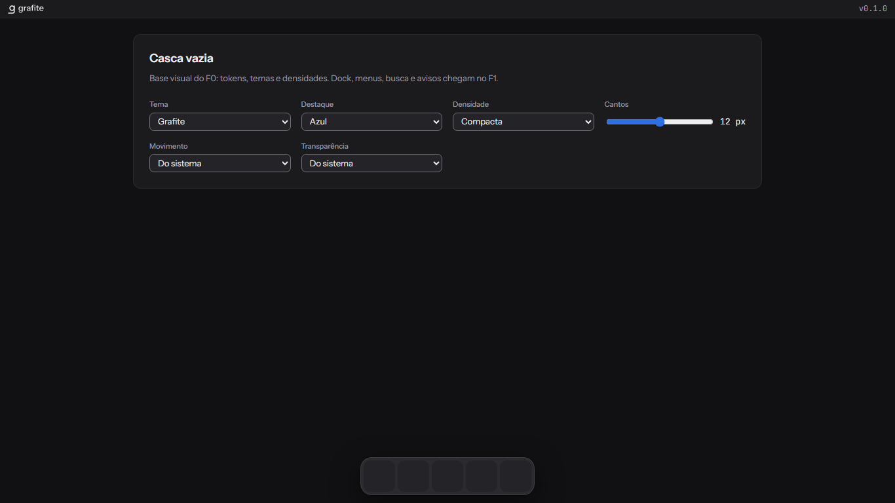
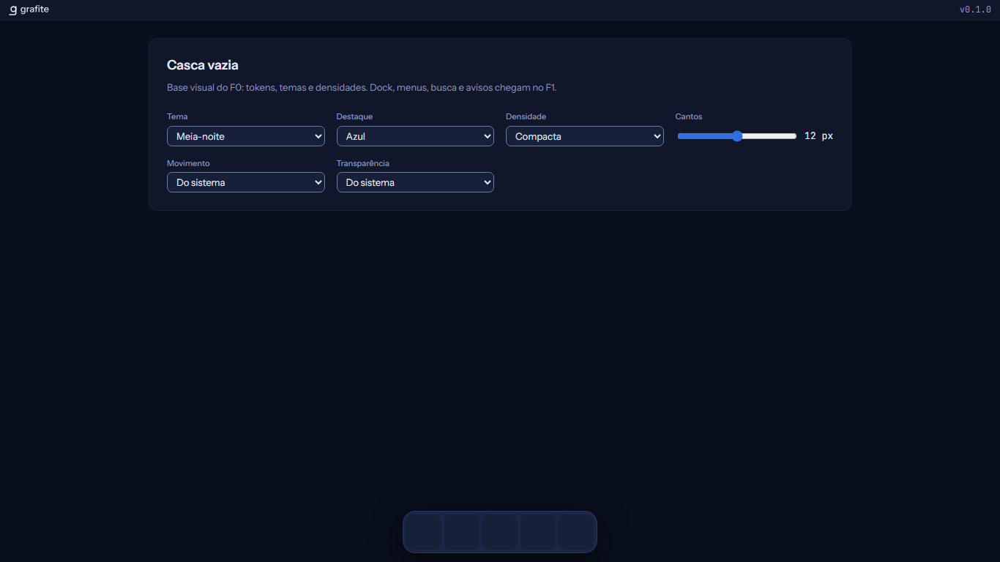
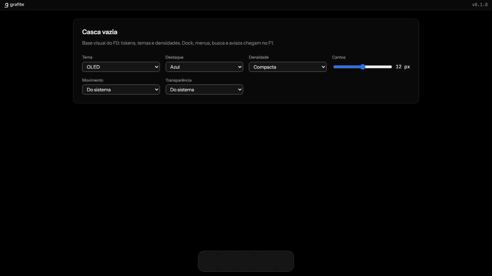
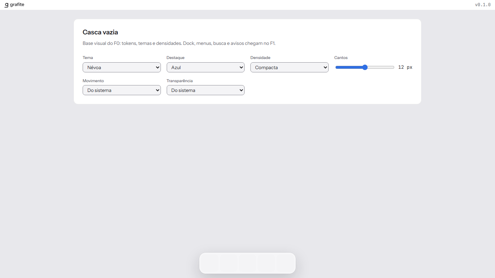
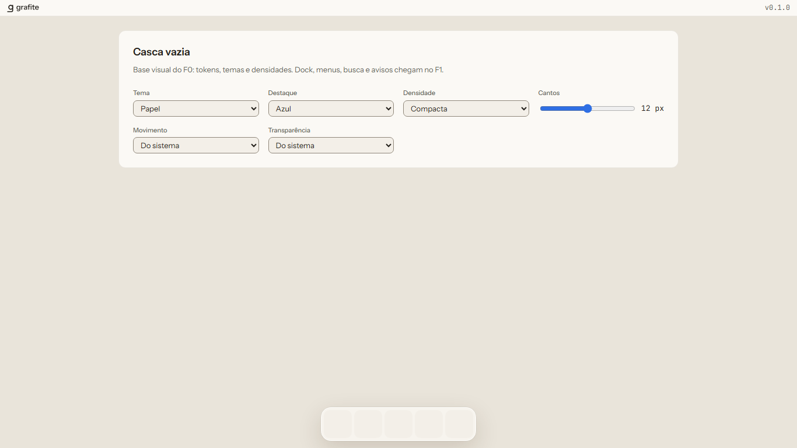
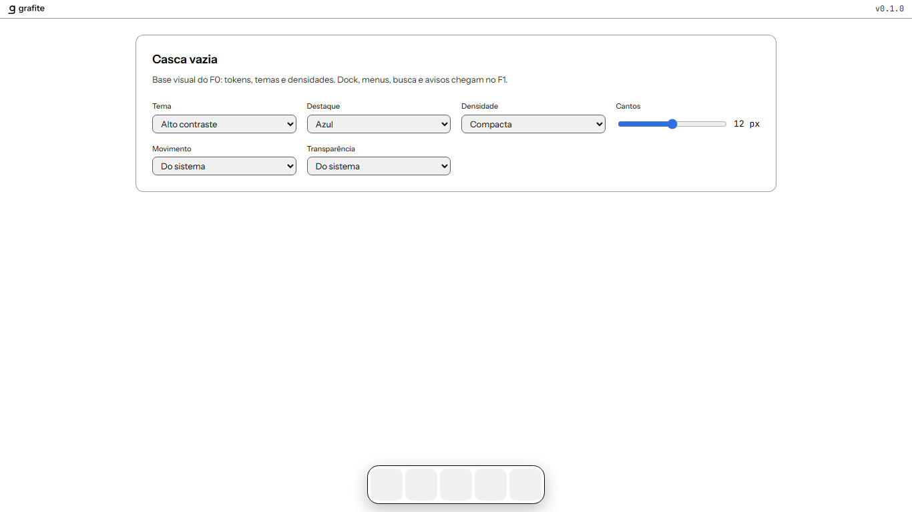

# Fechamento do F0

- **Data:** 26/09/2026. As verificações locais e as capturas são de 25/09.
- **Branch:** `f0-identidade-design-system-esqueleto`, no PR #1 do repositório anterior
- **Como reproduzir:** os comandos abaixo, na raiz do repositório. A conferência das combinações usa [`evidencias/combinacoes.mjs`](evidencias/combinacoes.mjs), com o `pnpm dev` rodando.

## Critérios de término (tarefa 12.1)

| Critério | Situação | Evidência |
|---|---|---|
| `pnpm dev` com todas as combinações de tema, destaque e densidade | Cumprido | As 72 combinações foram escolhidas pelo painel de aparência e conferidas contra o JSON DTCG (fundo, destaque e altura da linha): 0 divergências e 0 erros de console. O `/api/health` respondeu 200, com `status: ok` e `banco: ok`. Há uma captura da casca por tema em [`evidencias/`](evidencias/) |
| Catálogo sem violações | Cumprido | `pnpm test:stories`: 16 arquivos e 52 testes de interação e acessibilidade, com violação de acessibilidade tratada como erro |
| RLS verde | Cumprido | `pnpm test:integration`: 15 testes, com os cenários de isolamento e o teste-guarda de RLS |
| Contraste verde | Cumprido | `pnpm tokens:contraste`: AA nas 24 combinações de tema × destaque, com o relatório em [`docs/identidade/contraste.md`](../../../../docs/identidade/contraste.md) |
| Marca aplicada | Cumprido | `apps/web/e2e/marca.spec.ts` confere título, favicon, manifesto da PWA e marca na barra; ela também aparece nas capturas |
| Espelho do design system em ferramenta de design | Fora do F0 | Decisão do usuário durante a implementação (design, decisão 11) |

## Capturas da casca (`pnpm dev`, destaque azul, densidade compacta)

| Grafite | Meia-noite | OLED |
|---|---|---|
|  |  |  |

| Névoa | Papel | Alto contraste |
|---|---|---|
|  |  |  |

## Verificações

| Comando | Resultado |
|---|---|
| `pnpm lint` | Biome e verificador de cores literais sem apontamentos |
| `pnpm typecheck` | Os 7 pacotes e os scripts sem erro |
| `pnpm test` | 171 testes unitários: ui 121, API 18, scripts 17, web 6, coletor 5 e domínio 4 |
| `pnpm test:integration` | 15 testes com PostgreSQL real |
| `pnpm test:stories` | 52 testes do catálogo |
| `pnpm test:e2e` | 11 testes de ponta a ponta na web compilada |
| `pnpm test:visual` | 103 capturas iguais às referências, no contêiner do Playwright |
| `pnpm tokens:verificar` | Tokens gerados em dia |
| `pnpm contrato:verificar` | Cliente da API igual ao contrato |
| `pnpm marca:verificar` | Marca e derivados em dia |
| CI no GitHub Actions | Os 5 jobs verdes no commit `a32140a` do PR #1 do repositório anterior. As primeiras execuções revelaram três problemas de ambiente, corrigidos e registrados no design (Open Questions). Verdes de novo no `d058c0c`, com as actions na v7 e sem o aviso de depreciação do Node 20 (tarefa 11.4) |

## Pendências e observações

- **INPI:** a consulta ao INPI (classes 9 e 42) fica obrigatória antes de qualquer venda ([`docs/identidade/nome.md`](../../../../docs/identidade/nome.md)).
- **Spec mestre:** as mudanças do F0 foram revisadas e aprovadas pelo usuário em 26/09/2026 (tarefa 12.2).
- **`pnpm dev`:** o Node avisa DEP0190 (argumentos passados a um processo filho com `shell`). Não impede nada e fica para um ajuste.
